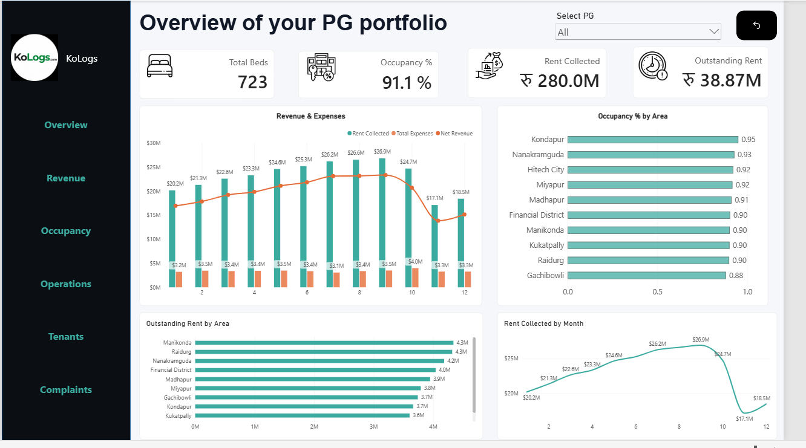

# PG Property Analytics

End-to-end Property Analytics solution built using Microsoft Fabric, SQL, Power BI and DAX.

## 📊 Dashboard Preview

## 🎯 Project Overview

This project demonstrates an end-to-end business intelligence solution for analyzing a multi-property PG (Paying Guest) portfolio.

The solution focuses on:

- Occupancy performance
- Rent collection
- Outstanding rent
- Revenue and expenses
- Property-level performance
- Area-level analysis
- Tenant movements
- Operational performance
- Complaints analysis

> **Note:** The dataset used in this project is synthetic and created for learning and portfolio demonstration purposes.

## 🛠️ Technology Stack

| Technology | Usage |
|---|---|
| Microsoft Fabric | Data warehouse and analytics platform |
| SQL | Data validation, transformation and business queries |
| Power BI | Interactive dashboards and reporting |
| DAX | Business KPIs and analytical measures |
| Excel / CSV | Source datasets |

## 🏗️ Architecture

Synthetic CSV Data
        ↓
Microsoft Fabric Warehouse
        ↓
SQL Validation & Business Queries
        ↓
Power BI Semantic Model
        ↓
DAX Measures
        ↓
Interactive Power BI Dashboard

💼 Skills Demonstrated
- SQL
- Microsoft Fabric
- Power BI
- DAX
- Data Modeling
- KPI Development
- Data Quality Validation
- Dashboard Design
- Business Analysis
- Analytical Reporting

